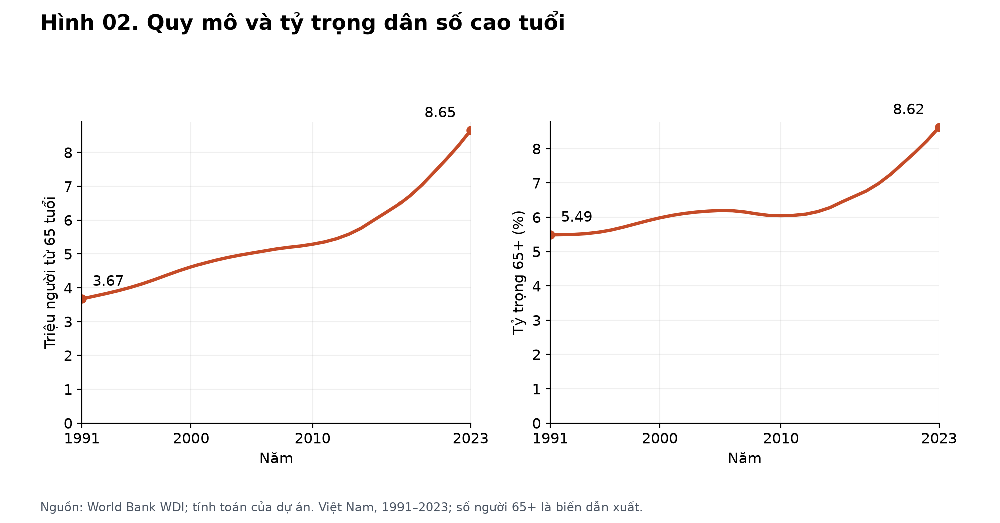
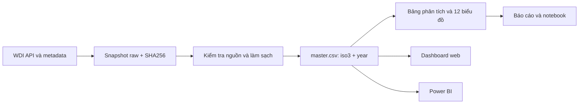

# Già hóa dân số Việt Nam, kinh tế và lao động

[](https://github.com/longieoo/vietnam-population-aging/actions/workflows/verify.yml)

Đồ án môn **Trực quan hóa dữ liệu**, phân tích xu hướng già hóa dân số Việt Nam trong mối liên hệ với phát triển kinh tế và lao động giai đoạn **1991–2023**. Dự án đi từ phản hồi API World Bank đến bảng dữ liệu chuẩn, 12 biểu đồ, dashboard web ngoại tuyến và báo cáo Power BI.



## Kết quả đáng chú ý

- Tỷ trọng dân số 65+ của Việt Nam tăng từ **5,49% lên 8,62%**; quy mô tăng từ **3,67 lên 8,65 triệu người**. Nhịp tăng tỷ trọng rõ hơn sau năm 2010.
- Trong lát cắt 2023, log GDP/người PPP và tỷ trọng 65+ có tương quan dương (**r ≈ 0,72; n = 197**). Đây là liên hệ giữa các nền kinh tế, không phải bằng chứng nhân quả.
- Tỷ trọng 15–64 và tỷ lệ có việc làm 15+ có liên hệ tuyến tính rất yếu (**r ≈ 0,08; n = 184**). Cơ cấu tuổi chưa đủ để giải thích khác biệt việc làm.

Mỗi phát hiện có bảng tính, cỡ mẫu và giới hạn tại [bảng minh chứng](outputs/tables/evidence_table.csv). Các chỉ tiêu lao động dùng dân số **15+** làm mẫu số, khác tỷ trọng 15–64 trên **tổng dân số**.

## Xem sản phẩm

| Sản phẩm | Cách xem |
|---|---|
| **Báo cáo PDF** | [Đọc báo cáo](reports/report_submission.pdf) trên GitHub; 35 trang gồm bìa |
| Dashboard web — 4 trang | Tải repository, mở [explorer.html](outputs/interactive/explorer.html) bằng trình duyệt; dữ liệu và thư viện đã nhúng |
| Power BI — 6 trang | Tải [PopulationAging.pbix](powerbi/PopulationAging.pbix), mở bằng Power BI Desktop; đã có dữ liệu nhúng |
| Power BI chỉnh sửa được | [PopulationAging.pbip](powerbi/PopulationAging.pbip), đi cùng hai thư mục Report và SemanticModel |
| Slide — khoảng 20 phút | [Canva, 20 trang](https://www.canva.com/d/DNbsAZLx2iAkTnS) |
| Notebook | [analysis.ipynb](notebooks/analysis.ipynb), [bản HTML](notebooks/analysis.html) tải về để đọc |
| Báo cáo chỉnh sửa | [Word](reports/report_submission.docx), [Markdown](reports/report_submission.md) |

GitHub hiển thị mã nguồn HTML; để tương tác cần tải file về. Power BI chưa xuất bản lên Service. Đổi tham số `SourceRoot` theo [hướng dẫn Power BI](docs/powerbi-guide.md) khi cần Refresh trên máy khác.

## Dòng dữ liệu



Snapshot `f802111fa64f0c25` có **217 nền kinh tế, 33 năm, 7.161 dòng và 17 cột**. Có 5.780 dòng đủ tám chỉ tiêu nguồn; mẫu mỗi biểu đồ xác định riêng theo các biến cần dùng. Loại vùng tổng hợp WDI, giữ nguyên giá trị thiếu và không nội suy. Biên nhận nguồn ở [source_manifest.json](data/metadata/source_manifest.json); định nghĩa ở [từ điển dữ liệu](docs/data-dictionary.md).

## Chạy trên máy cá nhân

Cần **Python 3.12**. Không cần mạng để dựng phân tích sau khi cài phụ thuộc và tải repository. Chạy trong thư mục chứa `run.py`.

```powershell
python -m venv .venv
.venv\Scripts\python.exe -m pip install -r requirements-core.txt
.venv\Scripts\python.exe run.py doctor
.venv\Scripts\python.exe run.py check
.venv\Scripts\python.exe run.py build
```

Trên Linux/macOS, thay `.venv\Scripts\python.exe` bằng `.venv/bin/python`. Cài `requirements.txt` nếu cần chạy lại notebook. Node.js cần cho kiểm thử mô hình dashboard:

```sh
node --test tests/dashboard_model_test.cjs
```

| Lệnh | Chức năng |
|---|---|
| `python run.py doctor` | Kiểm tra Python và phụ thuộc, không cài thêm hoặc tải dữ liệu |
| `python run.py build` | Tái tạo dữ liệu, bảng, biểu đồ và dashboard; giữ báo cáo đã biên tập |
| `python run.py build --notebook` | Dựng thêm notebook trong kernel mới; cần `requirements.txt` |
| `python run.py check` | Kiểm thử và đối chiếu nguồn, công thức, notebook, hình và sản phẩm |
| `python run.py powerbi` | Dựng lại PBIP từ CSV; không cập nhật PBIX tự động |
| `python run.py package --output ../population-aging.zip` | Tạo ZIP kèm manifest SHA256; kiểm tra CRC và từng tệp |
| `python run.py verify-archive ../population-aging.zip` | Kiểm tra gói ZIP đã tải hoặc sao chép |

`build --acquire` mới gọi nguồn trực tuyến. Không dùng tùy chọn này nếu muốn tái tạo đúng snapshot: nguồn có thể được điều chỉnh và kết quả khi đó cần rà soát lại. `build` ghi đè sản phẩm được sinh; lưu chỉnh sửa tay trước khi chạy. `build --pdf word` chỉ dùng trên Windows có Microsoft Word. Đóng Power BI Desktop trước khi dựng lại PBIP.

## Cấu trúc

```text
data/          raw, metadata và bảng chuẩn sau xử lý
src/           thu thập, biến đổi, phân tích, biểu đồ, dashboard và CLI
outputs/       bảng kết quả, PNG/SVG và dashboard HTML
powerbi/       PBIX, PBIP, mô hình và định nghĩa visual
reports/       báo cáo cuối và ảnh trong báo cáo
notebooks/     notebook đã chạy và bản HTML
scripts/       kiểm tra dashboard trong trình duyệt
tests/         kiểm thử số liệu, nguồn, dashboard và đóng gói
docs/          phương pháp, hướng dẫn và phạm vi kiểm chứng
```

## Kiểm tra và giới hạn

GitHub Actions cài môi trường sạch, dựng lại từ snapshot, đối chiếu sản phẩm, chạy kiểm thử JavaScript, kiểm tra dashboard trên máy tính/điện thoại và tạo ZIP đã xác minh. Xem trạng thái thực tế tại [Actions](https://github.com/longieoo/vietnam-population-aging/actions); phạm vi kiểm chứng ở [trạng thái dự án](docs/current-status.md).

Để kiểm tra giao diện tại máy cá nhân:

```sh
python -m pip install -r requirements-dev.txt
python -m ruff check .
python -m playwright install chromium
python scripts/check_dashboard.py
```

Dữ liệu là snapshot lịch sử, không cập nhật trực tiếp. Nhóm vùng/thu nhập theo metadata lúc tải, không phải phân loại lịch sử từng năm. Bản đồ khớp 170 nền kinh tế; 47 nền kinh tế không có hình học vẫn nằm trong bảng. Ngưỡng 8/10/12% là mốc phân tích; Việt Nam chưa đạt 10% trong cửa sổ nghiên cứu. Power BI dùng tương quan GDP gốc (~0,603), còn báo cáo và web dùng log GDP (~0,722); không đọc chúng như cùng một phép tính.

Xem [mục lục tài liệu](docs/README.md), [hướng dẫn mã](docs/code-guide.md), [nguồn và sử dụng lại](docs/sources-and-reuse.md). Báo cáo, Power BI Desktop và slide Canva là sản phẩm đã biên tập; pipeline không tự cập nhật các nội dung đó khi dữ liệu thay đổi.
